# SIEGE PREVIEW

**A free tech demo of Siege, a real-time strategy game fought on real places and drawn as a holographic command table. Two armies, three famous battlefields, one skirmish against the AI. It runs in your browser: no install, no account, no internet needed.**

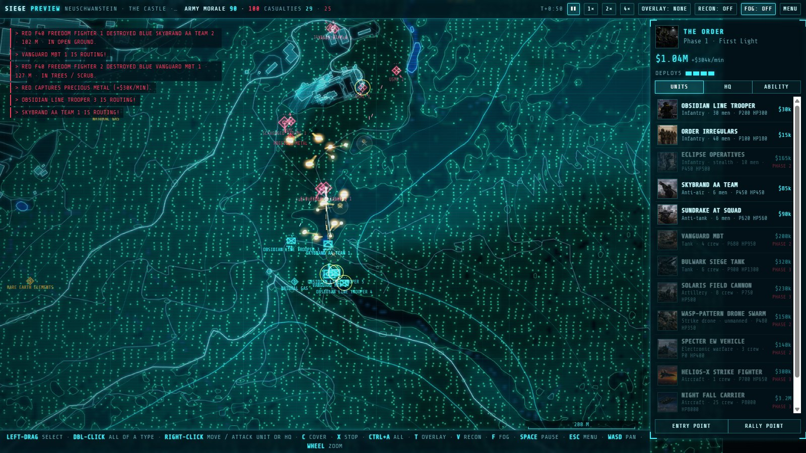

---

## Play it

1. **Download it:** on this page, **Code → Download ZIP**, then unzip it anywhere.
2. **Open `index.html`** in Chrome or Edge.
3. **Click once anywhere** to start the music. Browsers hold audio until you do.

Everything runs from the files on disk, offline. You need a desktop or laptop with a mouse and keyboard, and a screen of at least 1440 × 900.

---

## What's in the demo

**Skirmish.** You command one army from the south edge of the map; an AI commander leads the other from the north.

**Two armies.**
- **The NWR:** what is left of the United States, Britain and Russia. Conscripts, Marines and Royal Commandos, Javelin and Stinger teams, scavenged Abrams, Challengers and T-90s, the F40 fighter, the MLRS and Colonel Beltopsky. Its ability is the Supersonic Bomber Strike.
- **The Order:** conditioned soldiers who mean to bury the world under an engineered ice age. Obsidian Line Troopers, Eclipse Operatives, Vanguard and Bulwark tanks, Wasp-Pattern drone swarms, Helios-X fighters and the Night Fall Carrier. Its ability is the Eclipse Protocol, which turns your own soldiers against you.

**Three battlefields, built from the real ground.** Every building, road, wood, river and hill comes from OpenStreetMap, elevation data and satellite imagery. Press **V** in battle to see the satellite photo underneath.
- **Pisa · Piazza dei Miracoli.** The Leaning Tower, the cathedral and the baptistery on their open lawn, inside the medieval wall. Around them the old town fights house to house.
- **Neuschwanstein · The castle.** The castle on its crag above the Pöllat gorge, with Hohenschwangau village below and open meadows to the north. Steep forest covers the south.
- **Yellowstone · Old Faithful.** Bare, steaming ground along the Firehole River, the old inn and lodges, wide car parks, and pine forest all round.

**Realism mode.** Armies break; they are rarely wiped out. Losses, burning wrecks, being outnumbered and flanked all wear a unit's morale down, and broken units run for their own lines. Win by breaking the enemy army or destroying its HQ.

**Four difficulties:** Easy, Normal, Hard and Insane.

**The Armory.** Both armies' full rosters: every unit's cost, strength, speed, reach and special rules, each phase of the war they unlock, their abilities, and the lore behind them.

**The full sound:** every weapon, vehicle and voice effect, and seven soundtracks.

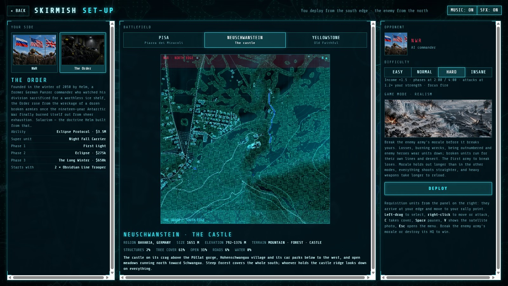

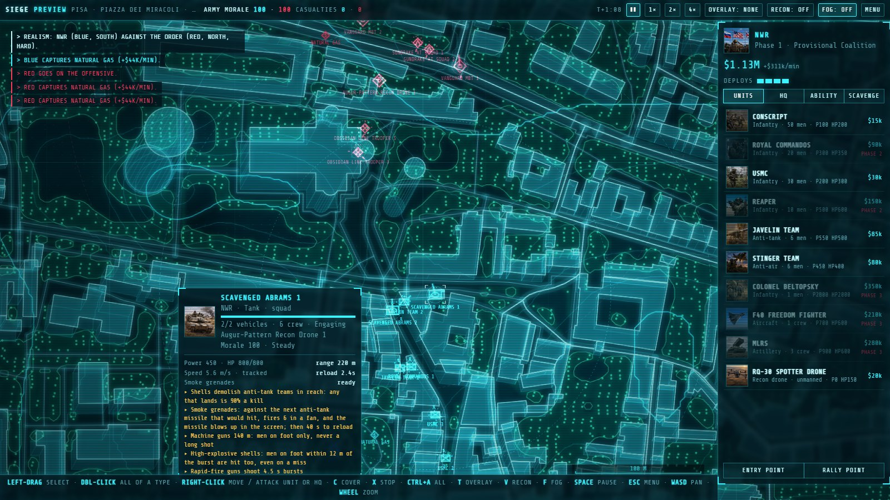

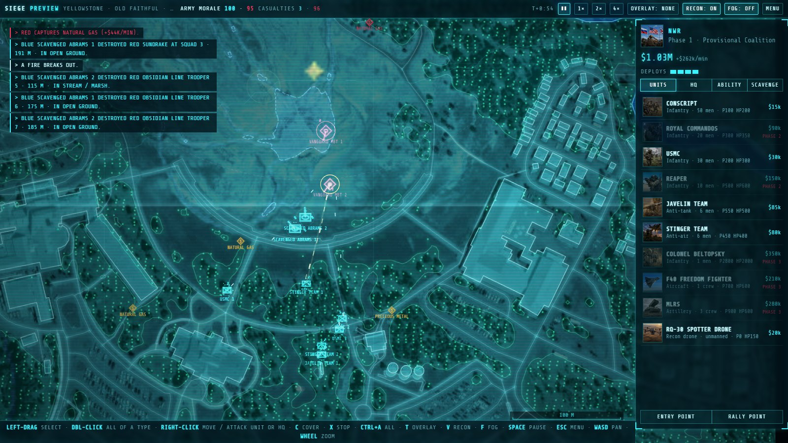

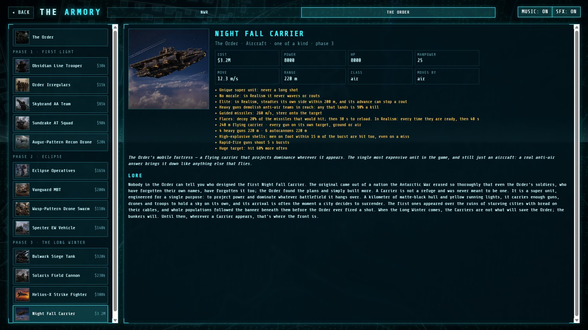

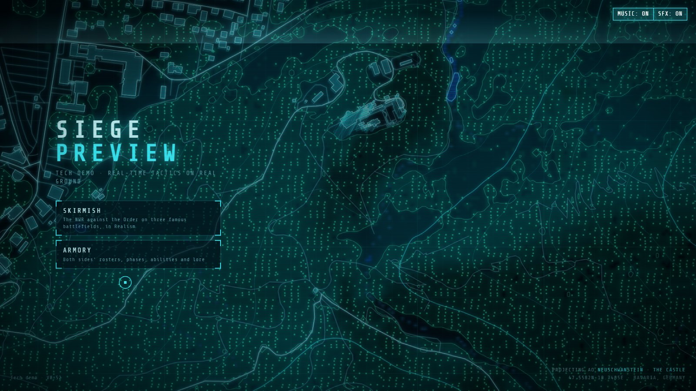

---

## How to play

**Nothing is built: everything is requisitioned.** Buy units from the panel on the right. They arrive at your map edge a few seconds later and move to your rally point. Money comes in every second, and faster while your units hold the resource points on the map. Buy Phase 2 and Phase 3 from the **HQ** tab to unlock the rest of your army.

**Every unit has a counter.**
- Tanks shred infantry.
- Anti-tank teams outrange tanks and kill them.
- Aircraft hit almost anything on the ground.
- Anti-air teams outrange aircraft and bring them down.
- Rifle squads beat anti-tank and anti-air teams up close.

**The ground matters.** Woods and buildings give cover, hills block sight and give the high ground, and fog of war hides what your units can't see.

| Control | Action |
|---|---|
| Left-drag | Select units |
| Double-click | Select all units of that type |
| Right-click | Move, or attack a unit or the enemy HQ |
| C / X | Take cover / stop |
| Ctrl+A | Select everything |
| WASD, mouse wheel | Pan, zoom |
| T / V / F | Terrain overlays / satellite photo / fog of war |
| Space / Esc | Pause / menu |

The **Entry point** and **Rally point** buttons at the bottom of the panel set where your units arrive and gather.

---

## Where it came from

I first made Siege in 2012, when I was about ten years old, in PowerPoint. It had the same lore, and it played the same way.

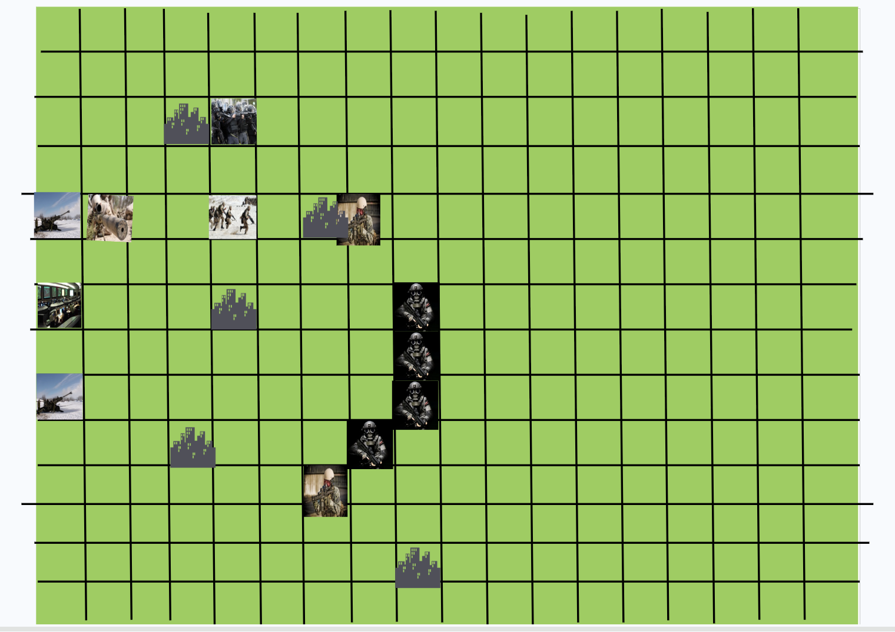

Then life got busy. At 24 I picked it up again and built a 2D version, *SIEGE: Fall of the States*: that PowerPoint, automated, as a turn-based game in HTML.

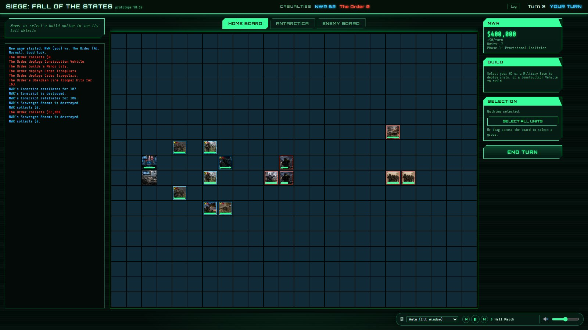

Then I started experimenting with real map data, and that became this game: the same war, fought in real time on real places. This preview is that game, while I iron out the full release.

---

## What 1.0 will be

The demo is one skirmish from a much bigger game: six armies, more than a hundred real battlefields, and a war that runs from 2031 to 2056. These screenshots are from the full game as it stands today. It is still in development, so details will change.

### The campaign

Four campaigns, 97 missions, each fought in real time on the real place it happens:
- **The Last Warm Year:** forty missions across all six armies, April 2055 to January 2056.
- **Inherit the Earth**, **United We Stand** and **Ghosts of the Old World:** the stories of how the machines, the NWR and the Order came to be.

Each mission opens with a briefing over the map and plays out in dialogue. Every decision you make carries forward to the missions that follow.

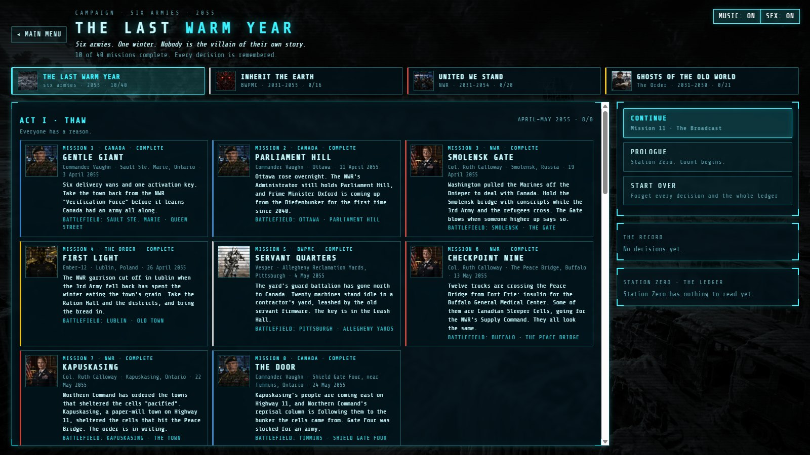

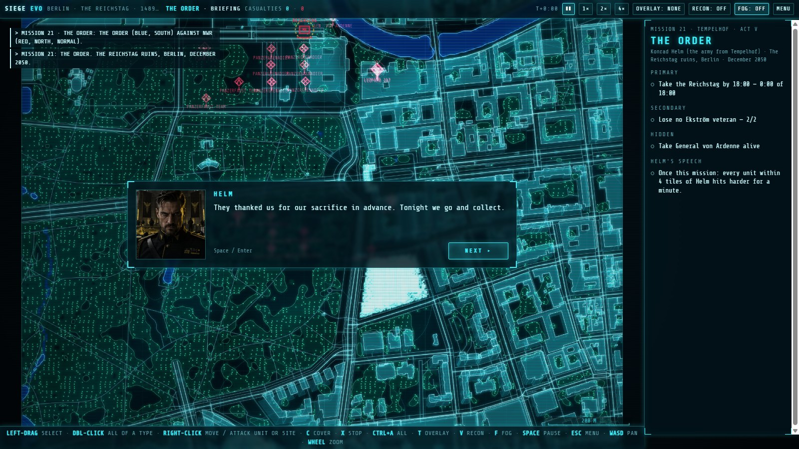

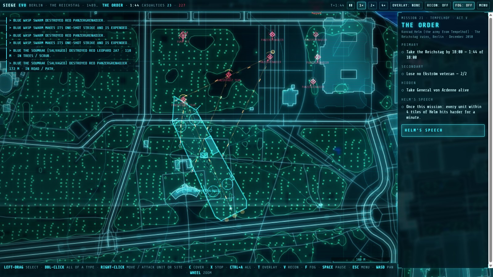

### The Grand Campaign: The Last Harvest

The Homel region, 2055. Play the NWR or the Order and take the region district by district, fortnight by fortnight, from January to December.
- **The map:** the region's 22 real districts, rivers and railways, and the seasons. Rivers freeze in winter and the marshes close to vehicles in the thaw.
- **The battles:** every battle can be fought on the real ground of its district, or auto-resolved. Armies next door arrive as reinforcements.
- **The people:** every district has a population, its attitude to each side, food, war damage and named local figures. You govern it with a standing policy and staff orders: food aid, rebuilding, councils, informants, checkpoints, reprisals.
- **The insurgency:** insurgents ambush, sabotage and assassinate. A district that hates you enough rises up and hands itself to the other side.
- **The voices:** your staff, your soldiers, the locals and the enemy all react to what you do.

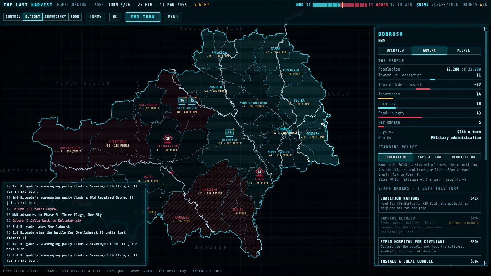

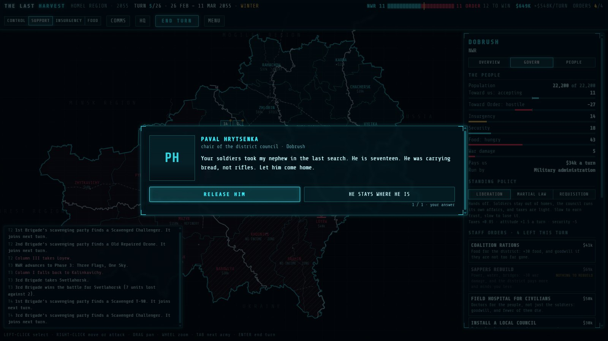

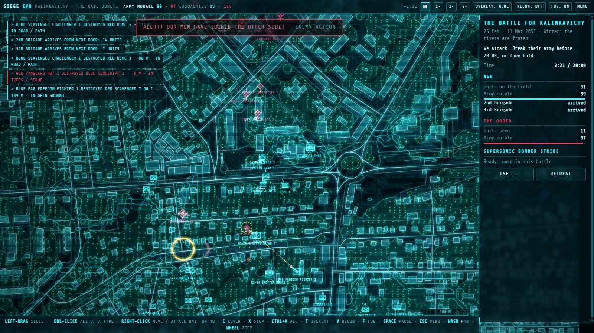

---

## Credits

Imagery © Esri, Maxar · Elevation © Mapzen/AWS Terrain Tiles · Map data © OpenStreetMap contributors (ODbL).
Interface font: Share Tech Mono, under the SIL Open Font License (`css/fonts/OFL.txt`).

The demo is free to download and play. All rights reserved: please don't redistribute modified copies.
